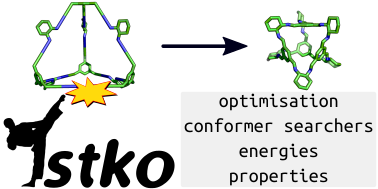

:maintainers:
    `andrewtarzia <https://github.com/andrewtarzia/>`_,
    `lukasturcani <https://github.com/lukasturcani/>`_
:documentation: https://stko-docs.readthedocs.io
:discord: https://discord.gg/zbCUzuxe2B



Overview
========

`stko <https://github.com/JelfsMaterialsGroup/stko>`_ is a Python library for
performing optimizations and calculations on complex molecules built using
`stk <https://github.com/lukasturcani/stk>`_. In the case of
optimizations, a clone of ``stk.Molecule`` is returned. For
calculators, a ``Results`` class are used to calculate and extract
properties of an ``stk.Molecule``. There is a Discord server
for ``stk``, which can be joined through https://discord.gg/zbCUzuxe2B.


Installation
============

To get ``stko``, you can install it with pip:

.. code-block:: bash

  pip install stko

Some optional dependencies are only available through conda:

.. code-block:: bash

  # for gfn-ff with topology constrains
  # This will not work on Windows at this stage
  # (https://pprcht.github.io/gfnff/python.html)
  pip install gfnff


  # for xtb
  mamba install xtb
  # for openbabel, assuming you are not using Python >= 3.13!
  mamba install openbabel


With OpenMM
-----------

To get ``stko`` and use ``OpenMM``, we had some installation issues. The
current solution is to first, in a new environment, install the ``OpenMM``
requirements:

.. code-block:: bash

  mamba install -c conda-forge openff-toolkit

Then install ``stko`` with pip, but with the cuda variant to take advantage
of GPU speed up (note that this is a heavy installation!).

.. code-block:: bash

  pip install stko[cuda]

We also removed the default installation of ``espaloma_charge`` that provides
the ML-based ``espaloma-am1bcc`` partial charges method. If users want this
package, create a new environment and install their dependancies (if this
fails, please check their
`instructions <https://github.com/choderalab/espaloma-charge>`_), then install
``stko``:

.. code-block:: bash

    mamba install -c conda-forge espaloma_charge openff-toolkit
    pip install stko[cuda]


Developer Setup
---------------

1. Install `just`_.
2. In a new virtual environment run:

.. code-block:: bash

  just dev

3. Run code checks:

.. code-block:: bash

  just check

.. _`just`: https://github.com/casey/just

Examples
========

We are constantly trying to add examples to the ``examples/`` directory
and maintain examples in the doc strings of ``Calculator`` and
``Optimizer`` classes.

``examples/basic_examples.py`` highlights basic optimisation with
``rdkit``, and ``xtb`` (if you have ``xtb`` available).


How To Contribute
=================

If you have any questions or find problems with the code, please submit
an issue.

If you wish to add your own code to this repository, please send us a
Pull Request. Please maintain the testing and style that is used
throughout ```stko``.


How To Cite
===========

If you use ``stko`` please cite

    https://github.com/JelfsMaterialsGroup/stko


Acknowledgements
================

We developed this code when working in the Jelfs group,
http://www.jelfs-group.org/, whose members often provide very valuable
feedback, which we gratefully acknowledge.
